# Point Detection Research

Approaches tested to automatically detect when points are being played in beach volleyball videos.

**Test video**: "Demi finale S2 - Dijon Part1" (YouTube, 23 min, 30fps, 1080p)
**Ground truth** (first 2 minutes, 5 points):
- Point 1: 0:05 - 0:15 (10s)
- Point 2: 0:25 - 0:56 (31s)
- Point 3: 1:16 - 1:24 (8s)
- Point 4: 1:34 - 1:42 (8s)
- Point 5: 1:57 - 2:11 (14s)

---

## Approach 1: RF-DETR Motion Signal + Threshold

**Idea**: Detect players with RF-DETR every 0.5s, compute displacement between frames, smooth, threshold.

**Problem**: Without persistent IDs, matching players between frames is noisy. When a player appears/disappears, it creates a false motion spike.

**Variants tested**:
- Simple nearest-neighbor matching: **56% accuracy**
- Hungarian matching: **64% accuracy**
- Rolling minimum motion: **64% accuracy**

**Why it failed**: The motion signal's rally/idle distributions overlap massively (rally median=44 vs idle median=35). Players walk during pauses, creating false activity.

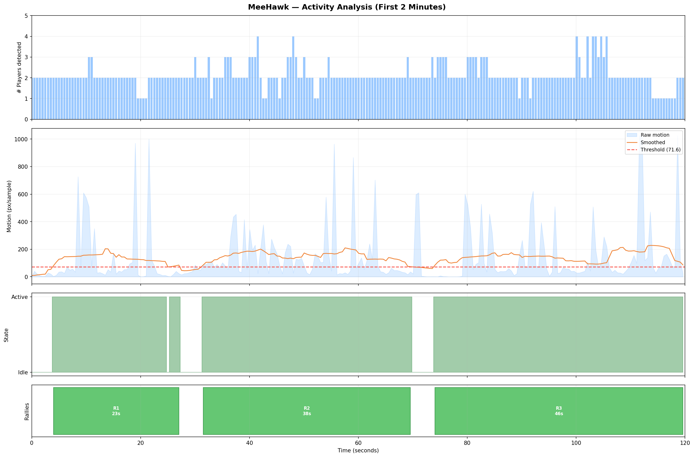
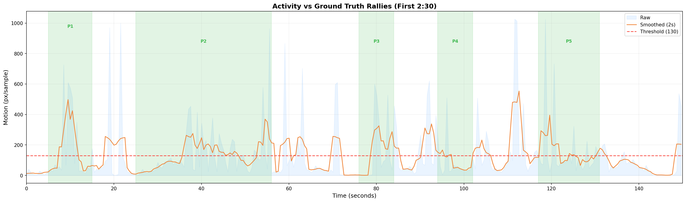

## Approach 2: Position Variance over Sliding Window

**Idea**: Measure how much player positions vary over a 3-6s window. During a rally = high variance, during pause = low.

**Result**: **50% accuracy** — same overlap problem as approach 1.

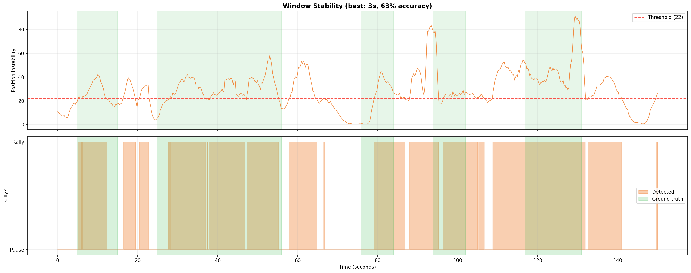

## Approach 3: Frame Differencing (global)

**Idea**: Compare consecutive frames pixel-by-pixel. More changed pixels = more activity.

**Result**: **56% accuracy** — player movement is a tiny fraction of total pixels. Background dominates.

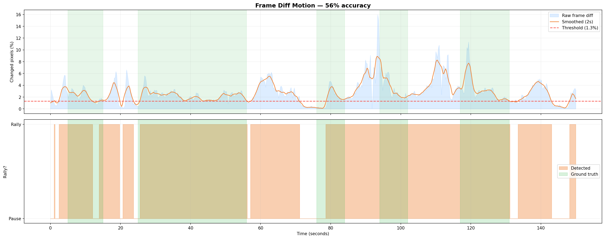

## Approach 4: Long-range Frame Difference

**Idea**: Compare each frame to the frame 4 seconds ago. During pause, frames should look identical.

**Result**: **57% accuracy** — rally and idle distributions nearly identical (ratio 0.9x).

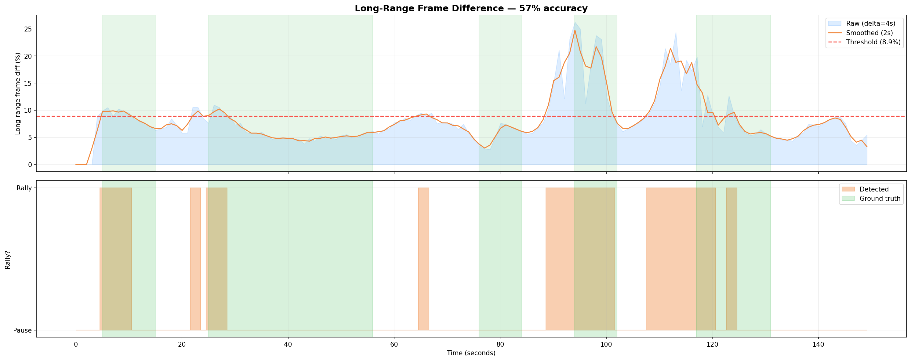

## Approach 5: Global Optical Flow

**Idea**: Dense optical flow (Farneback) between consecutive frames. Mean flow magnitude = activity.

**Result**: **53% accuracy** — flow dominated by background, not player movement.

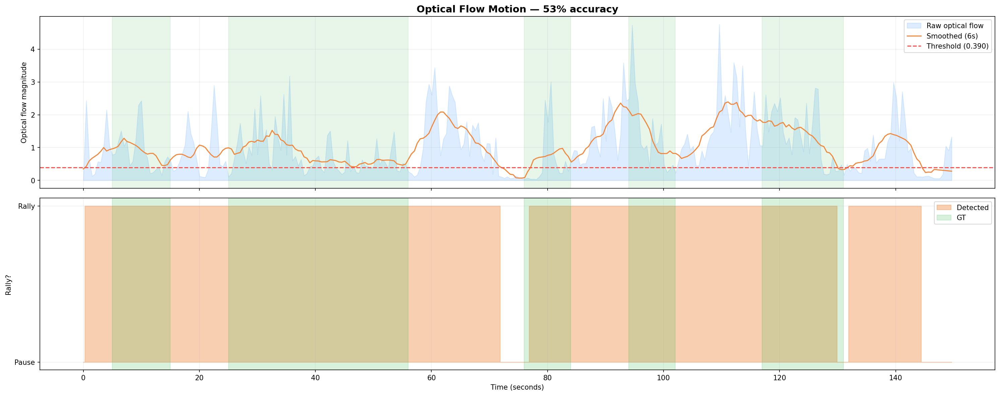

## Approach 6: Localized Optical Flow in Player Bboxes

**Idea**: Compute optical flow only within RF-DETR detected bounding boxes.

**Result**: **55% accuracy** — better signal shape (visible creux at pauses) but distributions still overlap too much for simple thresholding.

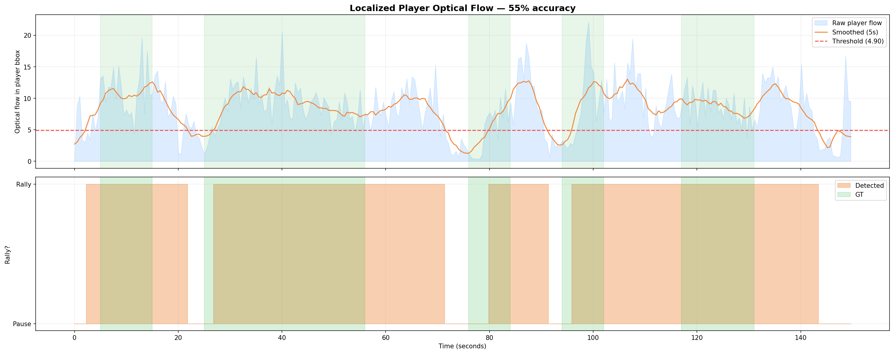

## Approach 7: Mini-Tracker (Hungarian + persistence)

**Idea**: Maintain a simple tracker with Hungarian assignment between frames, only count motion for matched players.

**Result**: **63% accuracy** — best pure CV approach. Cleanest signal but still too noisy.

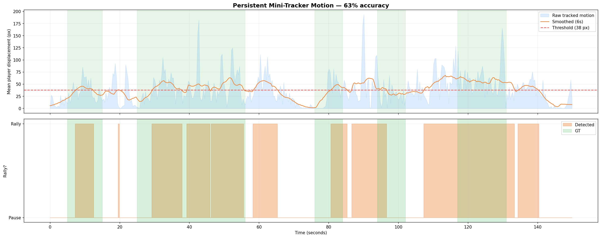

## Approach 8: Valley Detection on Smoothed Signal

**Idea**: Instead of thresholding activity, detect valleys (pauses) in the smoothed optical flow signal using `scipy.find_peaks` on the inverted signal.

**Result**: **5/5 GT rallies matched, but 4 false positives**. Finds all real points but fragments long pauses into multiple short segments.

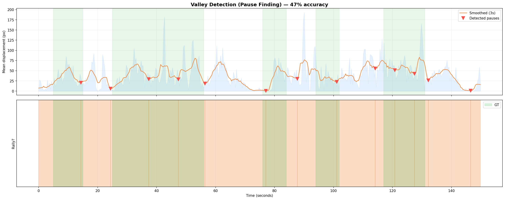
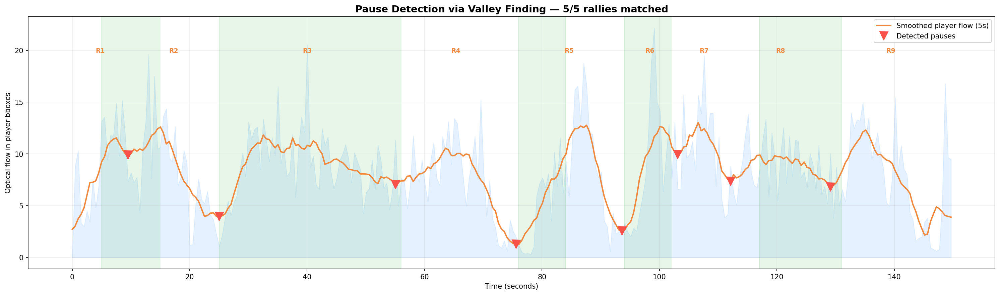

## Approach 9: Rolling Minimum Motion

**Idea**: A pause means ALL samples in a window are low. Use min(motion over window) instead of mean.

**Result**: **64% accuracy** — best separation (idle median=1.9 vs rally median=6.3) but still overlapping.

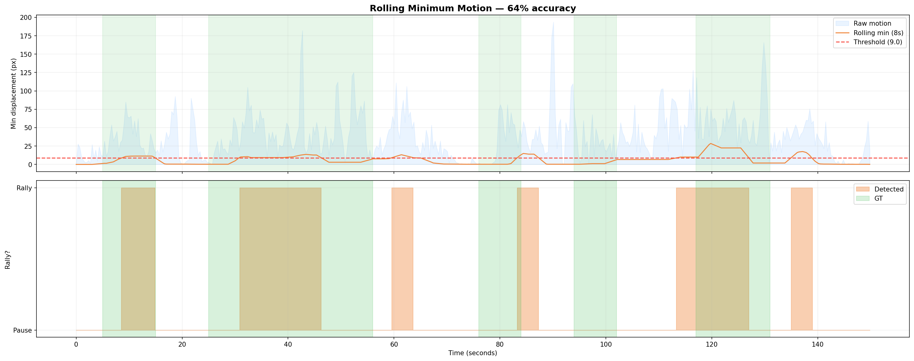

## Approach 10: Gemini VLM (final approach, adopted)

**Idea**: Use Gemini 2.0 Flash to classify 5-second windows as "playing" or "break". Run 5 times, take consensus (3/5 agreement).

**Results**:
| Variant | GT Matched | FP |
|---|---|---|
| Single run, precise timestamps | 3/5 | 0 |
| 2-pass (coarse + refine) | 5/5 | 11 |
| 5-run heatmap consensus | 2/5 | 1 |
| 10s windows, 5 runs | 4/5 | -2 |
| **5s windows, 5 runs (adopted)** | **3/5** | **0** |

**Why adopted**: Most consistent results across runs. Zero false positives. Misses short points in certain video sections but reliable for the majority of a match. Simple, no CV tuning needed. Works on any video without calibration.

**Limitations**: Gemini has trouble with certain video sections (possibly low camera quality or unusual angle). The 5s window resolution limits precision to ±5s on boundaries.

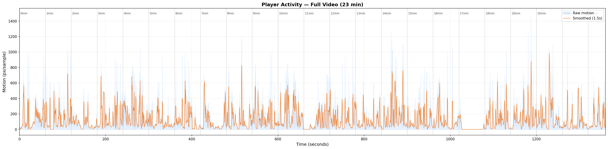

---

## Conclusion

Pure CV approaches failed because:
1. Player movement represents too few pixels to distinguish from background
2. Without persistent tracking IDs, frame-to-frame matching creates noise
3. Players walk during pauses, creating false activity signals

The VLM approach works because it understands the semantic meaning of "a point being played" rather than trying to infer it from low-level motion signals. The tradeoff is API cost and speed (~15s per 2-minute chunk × 5 runs).
